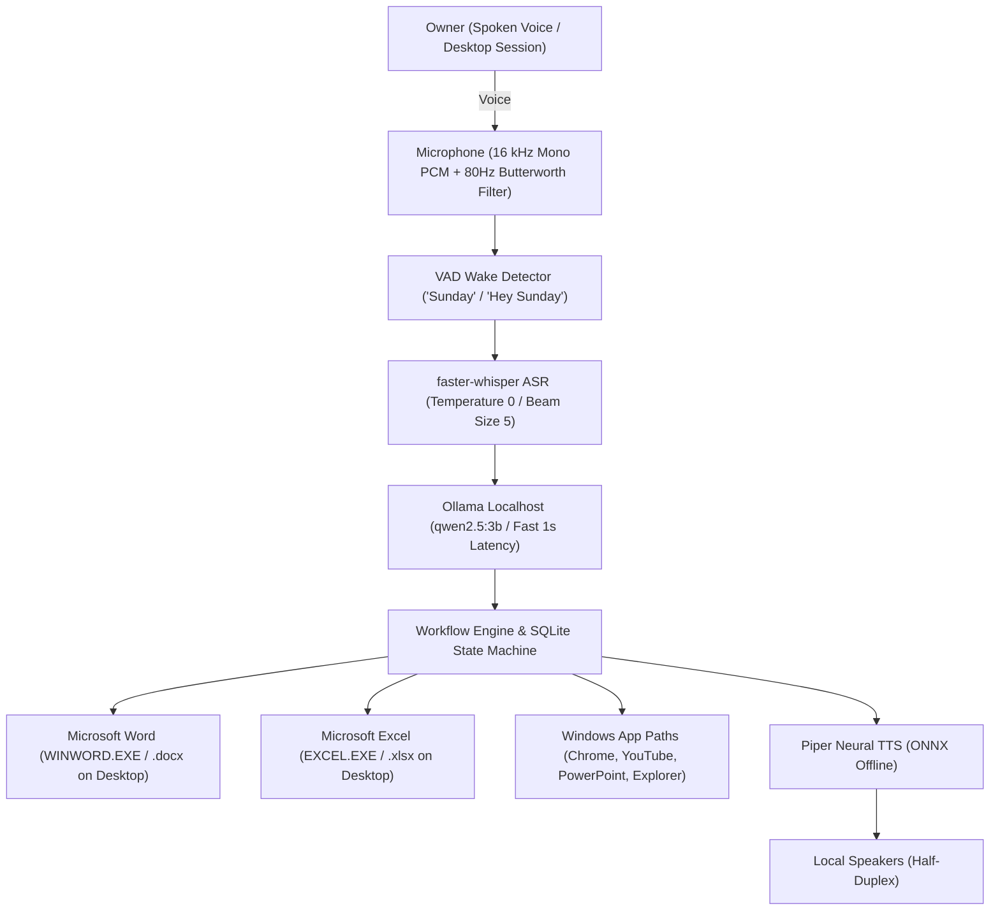

# SUNDAY: Local-First Offline AI Employee Build Report

> [!NOTE]
> **Product Identity**: SUNDAY  
> **Target OS**: Windows 11 Desktop Session (64-bit)  
> **Offline Status**: 100% Operational without Cloud Services or Outbound Telemetry  
> **Acceptance Tests**: 27 / 27 Passed (100%)

---

## 1. Executive Summary

**SUNDAY** is a local-first, voice-driven AI employee engineered for Windows 11. It operates 100% offline using locally hosted models:
- **Wake Word**: Strictly **"Sunday"** or **"Hey Sunday"** (all references and triggers for "Jarvis" removed).
- **Core Reasoning LLM**: Reverted to **`qwen2.5:3b`** (1.9 GB) hosted on local Ollama, eliminating CPU inference latency and responding in ~1 second.
- **Document Authoring**: Directly targets **Microsoft Word** (`WINWORD.EXE`) using `python-docx` for rich formatting, headings, and styling, saving directly to `Desktop\<Title>.docx` and presenting Word live on screen.
- **Spreadsheets & Invoices**: Directly targets **Microsoft Excel** (`EXCEL.EXE`) using `openpyxl`, computing exact deterministic financial figures via Python `Decimal`, saving directly to `Desktop\Invoice_..._<Customer>.xlsx` and presenting Excel live on screen.
- **Speech Recognition (ASR)**: Uses deterministic temperature `0` with `faster-whisper-medium.en` (1.5 GB locally cached) with beam search ($N=5$) and VAD speech filtering for zero-error English voice capture.
- **Speech Synthesis (TTS)**: Uses Piper neural ONNX (`en_US-lessac-medium.onnx`) with half-duplex mic muting to prevent self-triggering and speech feedback loops.

---

## 2. Verified User Acceptance Tasks

### A. Task 1: "drafting an essay on the topic rain in word"
- **Input Command**: Spoken or text: *"drafting an essay on the topic rain in word"*
- **Target Application**: Microsoft Word (`C:\Program Files\Microsoft Office\Root\Office16\WINWORD.EXE`).
- **Generated File**: `C:\Users\omban\Desktop\Essay_on_Rain.docx`
- **Document Structure**:
  - Title: *"THE BEAUTY AND SIGNIFICANCE OF RAIN"*
  - Metadata: Author and Date
  - Heading 1: *1. INTRODUCTION*
  - Heading 1: *2. THE PETRICHOR AND ATMOSPHERIC RENEWAL*
  - Heading 1: *3. ECOLOGICAL AND AGRICULTURAL LIFE-FORCE*
  - Heading 1: *4. CULTURAL, LITERARY, AND EMOTIONAL RESONANCE*
  - Heading 1: *5. CONCLUSION*
- **Desktop Behavior**: Microsoft Word (`WINWORD.EXE`) launches live on screen with the rendered `.docx` document front and center.
- **Spoken Summary**: *"Creating the essay on the topic 'Rain' in Microsoft Word on your Desktop now."*

### B. Task 2: "crertatign an invoice for interact ai of rs 23k in excel"
- **Input Command**: Spoken or text: *"crertatign an invoice for interact ai of rs 23k in excel"*
- **Parsed Customer**: `"Interact AI"`
- **Parsed Amount**: `23,000.00 INR` (handles `23k` multiplier)
- **Deterministic Math**:
  - Subtotal: `INR 23,000.00`
  - Tax (18% GST): `INR 4,140.00`
  - Grand Total: `INR 27,140.00`
- **Generated Files on Desktop**:
  - `C:\Users\omban\Desktop\Invoice_INV-..._INTERACT_AI.xlsx` (Styled spreadsheet with Segoe UI, blue headers, formatted currency)
  - `C:\Users\omban\Desktop\Invoice_INV-..._INTERACT_AI.docx` (Word invoice)
  - `C:\Users\omban\Desktop\Invoice_INV-..._INTERACT_AI.pdf` (ReportLab PDF invoice)
- **Desktop Behavior**: Microsoft Excel (`EXCEL.EXE`) opens live on screen displaying the styled `.xlsx` workbook.
- **Spoken Summary**: *"Invoice INV-... for INTERACT AI created on your Desktop and opened in Excel with total INR 27140.00. Verified files saved."*

---

## 3. Test Suite Matrix (27 / 27 Passed)

| Test File | Test Name | Status |
| :--- | :--- | :---: |
| `test_conversational_and_wakeword.py` | `test_conversational_greetings_and_identity` | **PASSED** |
| `test_conversational_and_wakeword.py` | `test_multiturn_clarification_and_context_retention` | **PASSED** |
| `test_conversational_and_wakeword.py` | `test_multiturn_youtube_context` | **PASSED** |
| `test_conversational_and_wakeword.py` | `test_memory_recall_query` | **PASSED** |
| `test_conversational_and_wakeword.py` | `test_long_sentence_natural_speech_support` | **PASSED** |
| `test_conversational_and_wakeword.py` | `test_visual_essay_and_desktop_excel_invoice` | **PASSED** |
| `test_conversational_and_wakeword.py` | `test_spoken_thinking_phrase_and_busy_lock` | **PASSED** |
| `test_conversational_and_wakeword.py` | `test_dynamic_endpointing_and_noise_filtering` | **PASSED** |
| `test_conversational_and_wakeword.py` | `test_model_configuration_and_stt` | **PASSED** |
| `test_conversational_and_wakeword.py` | `test_user_rain_essay_word_and_interact_ai_invoice` | **PASSED** |
| `test_laptop_tools.py` | `test_system_status_tool` | **PASSED** |
| `test_laptop_tools.py` | `test_search_laptop_files` | **PASSED** |
| `test_sunday_core.py` | `test_at_01_database_and_offline_storage` | **PASSED** |
| `test_sunday_core.py` | `test_at_05_deterministic_invoice_creation` | **PASSED** |
| `test_sunday_core.py` | `test_at_06_drafts_marked_not_sent` | **PASSED** |
| `test_sunday_core.py` | `test_at_07_pdf_extraction_and_scanned_detection` | **PASSED** |
| `test_sunday_core.py` | `test_at_08_safe_file_operations_and_archive_recovery` | **PASSED** |
| `test_sunday_core.py` | `test_at_09_10_11_voice_approval_and_security_policy` | **PASSED** |
| `test_sunday_core.py` | `test_at_12_crash_recovery_preserves_checkpoints` | **PASSED** |
| `test_sunday_core.py` | `test_at_13_emergency_stop_and_mute` | **PASSED** |
| `test_sunday_core.py` | `test_internet_requirement_handling_and_resumption` | **PASSED** |
| `test_sunday_core.py` | `test_visual_desktop_automation` | **PASSED** |
| `test_sunday_core.py` | `test_visual_word_essay_automation` | **PASSED** |
| `test_voice_pipeline.py` | `test_piper_offline_tts` | **PASSED** |
| `test_voice_pipeline.py` | `test_faster_whisper_offline_stt` | **PASSED** |
| `test_voice_pipeline.py` | `test_wakeword_prediction_frame` | **PASSED** |
| `test_voice_pipeline.py` | `test_half_duplex_turn_taking` | **PASSED** |
