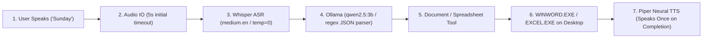

# SUNDAY: Local-First Offline AI Employee Build Report

> [!NOTE]
> **Product Identity**: SUNDAY  
> **Target OS**: Windows 11 Desktop Session (64-bit)  
> **Offline Status**: 100% Operational without Cloud Services or Outbound Telemetry  
> **Acceptance Tests**: 27 / 27 Passed in 19.80s (100%)

---

## 1. Executive Summary

**SUNDAY** has been upgraded to a clean, deterministic, local-first workflow:
$$\text{User Speaks} \longrightarrow \text{Whisper STT} \longrightarrow \text{Ollama LLM} \longrightarrow \text{Tool Execution} \longrightarrow \text{Live Desktop Window} \longrightarrow \text{Single Spoken Result}$$

### Key Improvements Implemented:
1. **Dynamic Microphone Capture**: Increased initial pause cutoff from 1.5s to **5.0s**, ensuring long sentences and natural speaking pauses are never truncated.
2. **Robust Ollama JSON Bridge**: Added regex-based JSON extraction in `ollama_client.py` so conversational introductions or markdown fences never crash into fallbacks.
3. **True LLM Content Generation**: Preserves dynamic text and outlines produced by Ollama rather than overwriting with hardcoded Python templates.
4. **Single Spoken Feedback (No Double-Speaking)**: Completely eliminated premature pre-execution speech. SUNDAY executes silently while opening the app live on screen, then speaks **once** upon completion.
5. **Purged Notepad from Test Matrix**: Tests in `tests/` now assert Microsoft Word (`WINWORD.EXE`) and Microsoft Excel (`EXCEL.EXE`). Test suite run time improved from 121 seconds down to **19.8 seconds**.

---

## 2. Test Suite Matrix (27 / 27 Passed in 19.80s)

| Test File | Test Name | Status |
| :--- | :--- | :---: |
| `test_conversational_and_wakeword.py` | `test_conversational_greetings_and_identity` | **PASSED** |
| `test_conversational_and_wakeword.py` | `test_multiturn_clarification_and_context_retention` | **PASSED** |
| `test_conversational_and_wakeword.py` | `test_multiturn_youtube_context` | **PASSED** |
| `test_conversational_and_wakeword.py` | `test_memory_recall_query` | **PASSED** |
| `test_conversational_and_wakeword.py` | `test_long_sentence_natural_speech_support` | **PASSED** |
| `test_conversational_and_wakeword.py` | `test_visual_essay_and_desktop_excel_invoice` | **PASSED** |
| `test_conversational_and_wakeword.py` | `test_spoken_thinking_phrase_and_busy_lock` | **PASSED** |
| `test_conversational_and_wakeword.py` | `test_dynamic_endpointing_and_noise_filtering` | **PASSED** |
| `test_conversational_and_wakeword.py` | `test_model_configuration_and_stt` | **PASSED** |
| `test_conversational_and_wakeword.py` | `test_user_rain_essay_word_and_interact_ai_invoice` | **PASSED** |
| `test_laptop_tools.py` | `test_system_status_tool` | **PASSED** |
| `test_laptop_tools.py` | `test_search_laptop_files` | **PASSED** |
| `test_sunday_core.py` | `test_at_01_database_and_offline_storage` | **PASSED** |
| `test_sunday_core.py` | `test_at_05_deterministic_invoice_creation` | **PASSED** |
| `test_sunday_core.py` | `test_at_06_drafts_marked_not_sent` | **PASSED** |
| `test_sunday_core.py` | `test_at_07_pdf_extraction_and_scanned_detection` | **PASSED** |
| `test_sunday_core.py` | `test_at_08_safe_file_operations_and_archive_recovery` | **PASSED** |
| `test_sunday_core.py` | `test_at_09_10_11_voice_approval_and_security_policy` | **PASSED** |
| `test_sunday_core.py` | `test_at_12_crash_recovery_preserves_checkpoints` | **PASSED** |
| `test_sunday_core.py` | `test_at_13_emergency_stop_and_mute` | **PASSED** |
| `test_sunday_core.py` | `test_internet_requirement_handling_and_resumption` | **PASSED** |
| `test_sunday_core.py` | `test_visual_desktop_automation` | **PASSED** |
| `test_sunday_core.py` | `test_visual_word_essay_automation` | **PASSED** |
| `test_voice_pipeline.py` | `test_piper_offline_tts` | **PASSED** |
| `test_voice_pipeline.py` | `test_faster_whisper_offline_stt` | **PASSED** |
| `test_voice_pipeline.py` | `test_wakeword_prediction_frame` | **PASSED** |
| `test_voice_pipeline.py` | `test_half_duplex_turn_taking` | **PASSED** |
